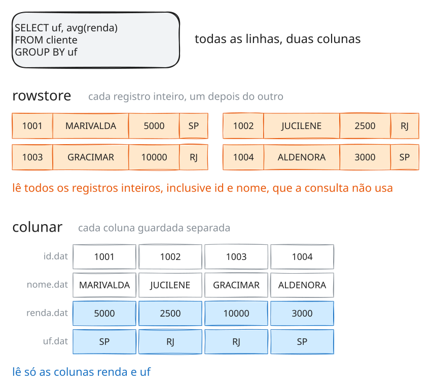
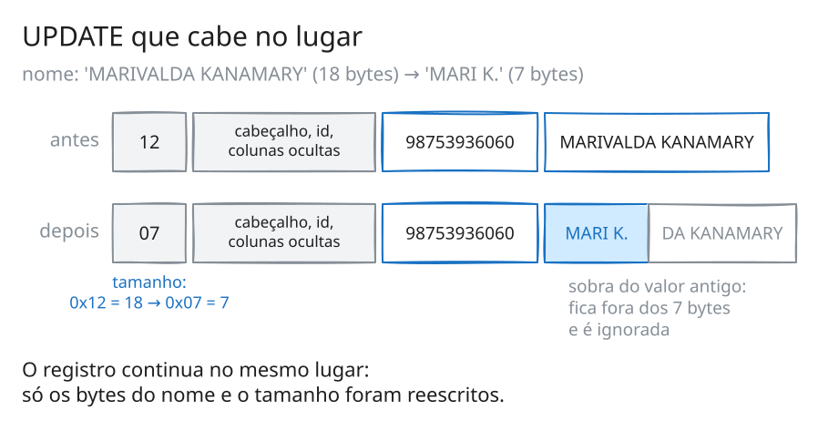

# Rowstore com MySQL 8 (InnoDB)

Author: Prof. Barbosa<br>
Contact: infobarbosa@gmail.com<br>
Github: [infobarbosa](https://github.com/infobarbosa)

Os bancos de dados relacionais tradicionais, como Oracle, MySQL, SQL Server e PostgreSQL, guardam os dados **orientados a linha** (*rowstore*): os atributos de um registro ficam juntos no disco, um ao lado do outro. Este material revisa essa ideia e depois a mostra na prática, abrindo o arquivo de dados de uma tabela do MySQL para ver onde cada byte de cada registro fica.

A Parte 1 é uma revisão: o que é um banco relacional, onde uma tabela mora no disco, em que o arranjo em linha difere do colunar e onde cada um se aplica. Na Parte 2 você cria uma tabela, insere, altera e apaga registros, e acompanha cada operação no arquivo `.ibd`, byte a byte.

Os comandos são copy-paste no terminal do laboratório, na ordem em que aparecem.

---

## O que você vai saber fazer ao final

- Explicar o que é um banco orientado a linha e o que significa "os atributos de um registro ficam juntos".
- Descrever o caminho de uma tabela até o disco: arquivo, página de 16 KB e bloco do sistema de arquivos.
- Comparar o arranjo em linha com o colunar e prever qual dos dois favorece uma consulta.
- Distinguir cargas OLTP e OLAP e situar o rowstore numa arquitetura de dados.
- Ler um registro do InnoDB num hexdump: cabeçalho, chave primária, colunas ocultas e colunas da tabela.
- Observar no arquivo o que `INSERT`, `DELETE` e `UPDATE` fazem com os bytes.

---

## Pré-requisitos

- Acesso ao **AWS Academy** (o ambiente é uma instância EC2 criada por um script, logo a seguir).
- Um navegador. Nada precisa ser instalado: o MySQL e as ferramentas de inspeção de arquivos já vêm no ambiente.

Fora da aula, o mesmo ambiente roda em qualquer máquina com **Docker**. Veja o [Apêndice B](#b-execução-local).

---

## Índice

[O ambiente](#o-ambiente)

**Parte 1 — Bancos de dados orientados a linha (revisão)**

1. [Rowstore](#1-rowstore)

**Parte 2 — O registro no disco**

2. [A base de dados](#2-a-base-de-dados)
3. [Operações em linhas (ou registros)](#3-operações-em-linhas-ou-registros)

[Referências](#referências)

**Apêndices**

- [A. Flush](#a-flush)
- [B. Execução local](#b-execução-local)
- [C. Troubleshooting](#c-troubleshooting)

---

## O ambiente

Este laboratório é executado em uma instância **AWS EC2** (`t3.medium`) provisionada automaticamente via **AWS CloudShell**.<br>
A instância executa um container Docker com o **code-server** (Visual Studio Code direto no navegador) e o **MySQL Server 8.0** já embutidos. Todos os comandos do tutorial são executados no terminal do code-server.

> **ATENÇÃO:**
> 1. **Região:** Utilize sempre a região **Norte da Virgínia (`us-east-1`)** no Console AWS.
> 2. **Custos:** A instância EC2 e o volume EBS consomem créditos do seu laboratório AWS Academy. Ao encerrar a aula, garanta que a instância esteja parada (**Stopped**) ou aguarde o desligamento automático da sessão.
> 3. **Não recrie a máquina para continuar o trabalho:** cada execução do `launch-lab.sh` cria uma instância **nova e vazia**, com data e hora no nome. Se a sua instância já existir, siga as instruções de [Retomando o laboratório](#retomando-o-laboratório). Se precisar mesmo recriar, encerre a anterior (**Instance state** > **Terminate instance**) para não consumir créditos.

### Passo 1: Abrir o AWS CloudShell
1. Faça login no Console da AWS através do seu painel do AWS Academy.
2. Certifique-se de que a região selecionada no canto superior direito é **N. Virginia (`us-east-1`)**.
3. No topo do console, clique no ícone do **AWS CloudShell** (`>_`) ao lado da barra de pesquisa.
4. Aguarde o terminal do CloudShell carregar.

### Passo 2: Executar o script de provisionamento
No terminal do CloudShell, execute:
```sh
curl -sS https://raw.githubusercontent.com/infobarbosa/mysql-rowstore-demo/main/launch-lab.sh | bash
```

O script realizará de forma automatizada:
- Descoberta da VPC padrão e de uma Subnet pública.
- Criação do Security Group `lab-mysql-sg` liberando as portas `8080` (IDE) e `22` (SSH).
- Lançamento de uma nova instância EC2 `lab-mysql-rowstore-AAAA-MM-DD_HH_MI_SS` (`t3.medium`, sufixo com a data e hora da execução, Ubuntu 24.04, 20 GB gp3).
- Instalação do Docker e inicialização do container `mysql-lab` (code-server + MySQL).
- Exibição do IP público e do link de acesso.

### Passo 3: Acessar a IDE
1. Abra no navegador o link exibido ao final do script: `http://<IP-PUBLICO>:8080`.
2. Caso a página não responda, **aguarde de 3 a 5 minutos** para que o Docker conclua o download da imagem e atualize o navegador.
3. O code-server abrirá diretamente na IDE, sem solicitar senha.
4. Abra um terminal: menu superior (três linhas horizontais) > **Terminal** > **New Terminal**.

Verifique se o MySQL está no ar:
```sh
mysql -u root -e "SELECT VERSION();"

```

Output esperado (a versão pode variar):
```
+-------------------------+
| VERSION()               |
+-------------------------+
| 8.0.46-0ubuntu0.24.04.4 |
+-------------------------+
```

>### Atenção!
> Os comandos desse tutorial devem ser executados no **terminal do code-server**.

### Retomando o laboratório
Se a sessão do AWS Academy expirar, a instância será parada. **Não execute o `launch-lab.sh` novamente:** ele criaria uma instância nova, sem o seu trabalho.
1. No Console AWS (`us-east-1`), acesse **EC2** > **Instances**.
2. Selecione a sua instância **`lab-mysql-rowstore-<data e hora>`** (se houver mais de uma, a mais recente) e clique em **Instance state** > **Start instance**.
3. Aguarde o status **Running** e copie o novo **Public IPv4 address** (ele muda a cada reinício).
4. Acesse `http://<NOVO_IP_PUBLICO>:8080`. O container reinicia automaticamente e os dados do MySQL são preservados.

### Convenções
Cada bloco de comando do roteiro tem na primeira linha um rótulo, como `# 3.b.1` (seção 3, subseção 3.b, primeiro bloco). Os blocos sem rótulo, logo depois, mostram a saída esperada. Os rótulos começam na seção 1.b; a Parte 1 tem poucos comandos, e a prática fica na Parte 2.

Alguns valores **mudam a cada execução**: no hexdump do arquivo `.ibd`, os *checksums* e *LSNs* no cabeçalho e no fim das páginas e, em cada registro, os campos ocultos DB_TRX_ID e DB_ROLL_PTR (seção 3.b); fora do hexdump, a data e a hora dos arquivos. Os seus não vão bater byte a byte com os do texto, e isso é esperado. Contagens de linhas e os trechos legíveis com os campos dos registros (`cpf` e `nome`), esses sim, devem bater.

Os comandos funcionam a partir de qualquer pasta.

---

# Parte 1 — Bancos de dados orientados a linha (revisão)

## 1. Rowstore

### 1.a. O banco relacional

Um banco de dados **orientado a linha** (*row-oriented*, ou *rowstore*) é o tipo mais tradicional de banco de dados: os atributos (colunas) de um registro são organizados em linhas e **armazenados juntos**. É o arranjo dos bancos relacionais que dominam o mercado há décadas:

<p align="center">
  &nbsp;&nbsp;
  &nbsp;&nbsp;
  &nbsp;&nbsp;
  
</p>
<p align="center"><sub>Oracle, MySQL, PostgreSQL e Microsoft SQL Server são marcas de seus respectivos titulares, usadas aqui apenas para identificar os produtos. Veja <a href="#marcas">Marcas</a>.</sub></p>

No banco relacional, os dados vivem em **tabelas**. Cada **linha** é um registro, por exemplo um cliente, e cada **coluna** é um atributo desse registro, como nome, CPF ou renda. A **chave primária** identifica cada linha sem ambiguidade, e o **SQL** é a linguagem para consultar e alterar as tabelas. Cada alteração acontece dentro de uma **transação**, com as garantias ACID: ou tudo acontece, ou nada acontece.


Guarde essa tabela: ela volta nas próximas seções. O laboratório da Parte 2 usa um recorte dela, só com as colunas `id`, `cpf` e `nome`.

### 1.b. Onde a tabela mora

"Tabela" é uma ideia do banco de dados. O sistema operacional não sabe o que é uma tabela, só sabe o que é um **arquivo**. E o disco não sabe o que é um arquivo, só sabe ler e gravar **blocos**. Entre a sua consulta SQL e os bytes no disco há uma descida de níveis:

![Quem conversa com quem, da esquerda para a direita, em ícones: você pede à aplicação, no celular, o cliente 1001; a aplicação envia ao banco de dados MySQL o SELECT * FROM cliente WHERE id = 1001; o MySQL pede ao sistema operacional, representado por uma engrenagem, a página 4 do arquivo cliente.ibd; o sistema operacional pede ao disco os 4 blocos dessa página; de volta, o disco entrega bytes, o sistema operacional entrega a página de 16 KB, o MySQL entrega as linhas e a aplicação mostra a tela. Cada nível só entende a sua unidade: a aplicação fala em telas, o MySQL em tabelas e páginas, o sistema operacional em arquivos, o disco em blocos](diagramas/01b1-quem-conversa-com-quem.svg)

A mesma descida, olhando para a tabela:

![A tabela descendo os níveis: a tabela ecommerce.cliente vira o arquivo /var/lib/mysql/ecommerce/cliente.ibd; o arquivo é dividido em páginas de 16 KB, p0 a p6, das quais p0 a p3 são de controle do arquivo, p4 guarda os registros e p5 e p6 estão livres; dentro da página 4, depois do cabeçalho e dos registros infimum e supremum, os registros ficam inteiros, um depois do outro, com id, cpf e nome lado a lado, seguidos do espaço livre e do diretório; cada página corresponde a 4 blocos de 4 KB do sistema de arquivos](diagramas/01b2-descendo-os-niveis.svg)

| Nível | Neste laboratório |
|---|---|
| **tabela** | `ecommerce.cliente` |
| **arquivo** | `/var/lib/mysql/ecommerce/cliente.ibd`: no MySQL, cada tabela ganha o seu próprio arquivo `.ibd` |
| **página** | a unidade com que o InnoDB, o motor de armazenamento do MySQL, lê e grava: 16 KB |
| **bloco** | a unidade do sistema de arquivos: 4 KB |

A peça que define o rowstore está no meio da segunda imagem: **dentro da página, cada registro fica inteiro**, com todos os seus atributos lado a lado. Quem lê a página para buscar um cliente traz junto, de uma vez, todos os dados desse cliente.

Três comandos mostram esses níveis no seu ambiente. Cada banco de dados do MySQL é uma pasta dentro de `/var/lib/mysql`:

```sh
# 1.b.1
ls -1d /var/lib/mysql/*/

```

```
/var/lib/mysql/#innodb_redo/
/var/lib/mysql/#innodb_temp/
/var/lib/mysql/mysql/
/var/lib/mysql/performance_schema/
/var/lib/mysql/sys/
```

As pastas `mysql`, `performance_schema` e `sys` são databases do próprio MySQL; as que começam com `#` são de uso interno do InnoDB. A `ecommerce`, que você cria na seção 2, vai aparecer aqui também. O tamanho da página do InnoDB é uma configuração do servidor:

```sh
# 1.b.2
mysql -u root -e "SHOW VARIABLES LIKE 'innodb_page_size';"

```

```
+------------------+-------+
| Variable_name    | Value |
+------------------+-------+
| innodb_page_size | 16384 |
+------------------+-------+
```

São 16.384 bytes, ou seja, 16 KB. Já o tamanho do bloco é do sistema de arquivos onde o MySQL grava:

```sh
# 1.b.3
stat -f -c 'tamanho do bloco: %S bytes' /var/lib/mysql

```

```
tamanho do bloco: 4096 bytes
```

Uma página de 16 KB ocupa, portanto, 4 blocos de 4 KB.

### 1.c. Linha × coluna

Guardar o registro inteiro junto é ótimo quando a consulta quer o registro inteiro, e desperdiça leitura quando a consulta quer poucas colunas de muitos registros. Os **bancos colunares** (*column-oriented*, ou *columnstore*) fazem o arranjo inverso: guardam cada coluna separada, com os valores de todos os registros em sequência.

Compare duas consultas sobre a mesma tabela `cliente`, gravada dos dois jeitos:




| Consulta | Rowstore | Colunar |
|---|---|---|
| `SELECT * FROM cliente WHERE id = 1002`: um registro, todas as colunas | lê um registro só, com os bytes juntos | busca um valor em cada coluna e monta a linha |
| `SELECT uf, avg(renda) FROM cliente GROUP BY uf`: todos os registros, duas colunas | lê todos os registros inteiros, inclusive as colunas que não usa | lê só as duas colunas |

Com 7 clientes a diferença é invisível. Com 100 milhões de clientes e 30 colunas de tamanho parecido, a segunda consulta lê, no rowstore, cerca de 15 vezes mais bytes do que precisa: 30 colunas para usar 2. Os bancos colunares ainda comprimem muito melhor, porque valores da mesma coluna se parecem entre si: a coluna `uf` é uma sequência de `SP`, `RJ`, `MG`…

O arranjo colunar é o assunto do laboratório [clickhouse-columnstore-demo](https://github.com/infobarbosa/clickhouse-columnstore-demo). E não confunda colunar com **wide-column**, o modelo do Cassandra, que apesar do nome guarda linhas: veja o laboratório [cassandra-widecolumn-demo](https://github.com/infobarbosa/cassandra-widecolumn-demo).

### 1.d. Quem são e onde se aplicam

Os bancos relacionais, todos orientados a linha, ocupam o topo do [ranking de popularidade do DB-Engines](https://db-engines.com/en/ranking) há anos. A tabela mostra a pontuação dos quatro primeiros em cinco momentos:

| DBMS | jul/2023 | nov/2024 | set/2025 | mai/2026 | nov/2026 |
|---|---:|---:|---:|---:|---:|
| Oracle | 1256 | 1317 | 1171 | 1143 | 1096 |
| MySQL | 1150 | 1018 | 892 | 856 | 823 |
| Microsoft SQL Server | 922 | 800 | 717 | 701 | 694 |
| PostgreSQL | 618 | 654 | 657 | 683 | 690 |

Os quatro mantêm as quatro primeiras posições em todas as medições, mas as trajetórias diferem: o MySQL perdeu cerca de 28% da pontuação desde 2023, enquanto o PostgreSQL subiu e, em novembro de 2026, ficou a 4 pontos do SQL Server. Logo abaixo, Snowflake (6º) e Databricks (7º), plataformas analíticas, estão entre os dez primeiros.

> A pontuação mede **popularidade**: menções na web, buscas, discussões técnicas, vagas de emprego e perfis profissionais ([método](https://db-engines.com/en/ranking_definition)). Não mede número de instalações nem participação de mercado. Os valores mudam todo mês; consulte o ranking atualizado no link.

O que explica esse topo é o tipo de trabalho que quase todo sistema tem: **OLTP** (*online transaction processing*), o processamento transacional.

![Dois padrões de acesso. OLTP, o terreno do rowstore: muitos usuários fazem INSERT, UPDATE e SELECT por chave, cada um tocando poucas linhas inteiras; operações pequenas, leitura e escrita o tempo todo, resposta em milissegundos e transação ACID; exemplos: carrinho e pedidos, cadastro, core bancário, ERP. OLAP, o terreno do colunar: poucos analistas fazem consultas enormes, como SELECT uf, avg(renda) GROUP BY uf, que tocam poucas colunas de todas as linhas; quase só leitura, resposta em segundos ou minutos, agregações; exemplos: BI, dashboards, relatórios, ciência de dados](diagramas/01d-oltp-x-olap.svg)

| Caso de uso | Por que o rowstore se encaixa |
|---|---|
| **Pedidos e carrinho** de um e-commerce | cada operação lê ou grava um pedido inteiro, dentro de uma transação |
| **Cadastro** de clientes, produtos, contas | consulta e alteração pontual, pela chave |
| **Core bancário e pagamentos** | muitas transações simultâneas, com garantia ACID |
| **ERP e CRM** | muitas tabelas relacionadas, `JOIN` e integridade referencial |
| **Backend de aplicações web** | o padrão de acesso típico: ler e gravar poucas linhas por requisição |

O rowstore é a escolha errada quando a carga é **analítica**: relatórios e painéis que varrem milhões de linhas e poucas colunas. Nesse caso, um banco colunar ou um data lake em Parquet lê uma fração dos bytes. O mesmo vale para séries temporais em volume muito alto (veja o laboratório [influxdb-timeseries-demo](https://github.com/infobarbosa/influxdb-timeseries-demo)) e para leitura em escala global, distribuída em muitos servidores (o caso do Cassandra).

### 1.e. Na arquitetura

Na prática, os dois mundos convivem. O banco orientado a linha é a **fonte da verdade** das transações, e uma cópia dos dados segue para os sistemas analíticos:


- **CDC** (*change data capture*) captura cada mudança do banco transacional e a entrega a outros sistemas, quase em tempo real.
- **ETL** (*extract, transform, load*) faz o mesmo em lote, por exemplo uma vez por noite.
- Do outro lado, os dados ganham o formato que a análise precisa: colunas, em Parquet ou num banco colunar. Esse é o assunto dos laboratórios [iceberg-tableformat-demo](https://github.com/infobarbosa/iceberg-tableformat-demo) e [clickhouse-columnstore-demo](https://github.com/infobarbosa/clickhouse-columnstore-demo).

Na Parte 2 você desce até o nível mais baixo das imagens da seção 1.b: cria a tabela `cliente`, insere registros e os encontra no arquivo `cliente.ibd`, byte a byte.

---

# Parte 2 — O registro no disco

## 2. A base de dados

### 2.a. Database `ecommerce`

Criando a base de dados *ecommerce*:
```sh
# 2.a.1
mysql -u root -e \
"CREATE DATABASE IF NOT EXISTS ecommerce;"

```

### 2.b. Tabela `cliente`

Criando a tabela *cliente*:
```sh
# 2.b.1
mysql -u root -e \
"CREATE TABLE ecommerce.cliente(
    id int PRIMARY KEY,
    cpf text,
    nome text
);"

```

Verificando se deu certo
```sh
# 2.b.2
mysql -u root -e \
"DESCRIBE ecommerce.cliente;"
```

Output esperado:
```
+-------+------+------+-----+---------+-------+
| Field | Type | Null | Key | Default | Extra |
+-------+------+------+-----+---------+-------+
| id    | int  | NO   | PRI | NULL    |       |
| cpf   | text | YES  |     | NULL    |       |
| nome  | text | YES  |     | NULL    |       |
+-------+------+------+-----+---------+-------+
```

#### O arquivo da tabela

A tabela ganhou o seu arquivo, dentro da pasta da database, como na segunda imagem da seção 1.b:

```sh
# 2.b.3
ls -l /var/lib/mysql/ecommerce

```

```
total 112
-rw-r----- 1 mysql mysql 114688 Nov  8 15:03 cliente.ibd
```

São 114.688 bytes, exatamente 7 páginas de 16 KB: as páginas p0 a p6 da imagem. O arquivo nasce com páginas de controle e espaço livre, mesmo sem nenhum registro. A data e a hora vão ser as do seu ambiente.

O formato de cada registro dentro da página é uma propriedade da tabela:

```sh
# 2.b.4
mysql -u root -e \
"SELECT TABLE_NAME, ENGINE, ROW_FORMAT
FROM information_schema.TABLES
WHERE TABLE_SCHEMA = 'ecommerce';"

```

```
+------------+--------+------------+
| TABLE_NAME | ENGINE | ROW_FORMAT |
+------------+--------+------------+
| cliente    | InnoDB | Dynamic    |
+------------+--------+------------+
```

`InnoDB` é o motor de armazenamento: a parte do MySQL que organiza os arquivos, as páginas e os registros. `Dynamic` é o *formato de linha* (*row format*), o padrão do MySQL 8: a regra de como os bytes de cada registro são dispostos. O nome não tem a ver com "rowstore"; ele descreve a codificação de cada linha, que você vai ler byte a byte na seção 3.b.

## 3. Operações em linhas (ou registros)

### 3.a. 1o. Insert
```sh
# 3.a.1
mysql -u root -e \
"INSERT INTO ecommerce.cliente(id, cpf, nome)
VALUES (10, '11111111111', 'marcelo barbosa');"

```

Verificando:
```sh
# 3.a.2
mysql -u root -e \
"SELECT * FROM ecommerce.cliente;"
```

Output:
```
+----+-------------+-----------------+
| id | cpf         | nome            |
+----+-------------+-----------------+
| 10 | 11111111111 | marcelo barbosa |
+----+-------------+-----------------+
```

### 3.b. O arquivo de dados

> **Dica:** O InnoDB não grava as alterações no arquivo de dados imediatamente; elas ficam em memória e são descarregadas para o disco em segundo plano. Se os comandos abaixo não exibirem os dados recém-inseridos, aguarde alguns segundos ou force a gravação conforme o [Apêndice A](#a-flush):
> ```
> mysql -u root -e "FLUSH LOCAL TABLES ecommerce.cliente FOR EXPORT;"
> ```

Verificando o conteúdo do arquivo `cliente.ibd`
```sh
# 3.b.1
cat /var/lib/mysql/ecommerce/cliente.ibd

```

Output (trecho; entre os registros, o terminal mostra caracteres ilegíveis, que mudam a cada execução):
```
(...)
infimum
supremum
11111111111marcelo barbosa
(...)
```

Agora via utilitário `hexdump`:

> O utilitário `hexdump` exibe o conteúdo do arquivo em formato hexadecimal. Na coluna da direita, é possível visualizar os dados legíveis (ASCII). Observe como os campos `cpf` e `nome` aparecem **lado a lado**, sem separadores — essa é a essência do armazenamento em linha.

```sh
# 3.b.2
hd -C /var/lib/mysql/ecommerce/cliente.ibd
```

Output:
```
0000fff0  00 00 00 00 00 70 00 63  c1 d7 f5 53 01 26 90 1d  |.....p.c...S.&..|
00010000  94 03 4f e6 00 00 00 04  ff ff ff ff ff ff ff ff  |..O.............|
00010010  00 00 00 00 01 26 94 47  45 bf 00 00 00 00 00 00  |.....&.GE.......|
00010020  00 00 00 00 00 02 00 02  00 ab 80 03 00 00 00 00  |................|
00010030  00 80 00 05 00 00 00 01  00 00 00 00 00 00 00 00  |................|
00010040  00 00 00 00 00 00 00 00  00 99 00 00 00 02 00 00  |................|
00010050  00 02 02 72 00 00 00 02  00 00 00 02 01 b2 01 00  |...r............|
00010060  02 00 1d 69 6e 66 69 6d  75 6d 00 02 00 0b 00 00  |...infimum......|
00010070  73 75 70 72 65 6d 75 6d  0f 0b 00 00 00 10 ff f0  |supremum........|
00010080  80 00 00 0a 00 00 00 00  05 13 82 00 00 01 0b 01  |................|
00010090  10 31 31 31 31 31 31 31  31 31 31 31 6d 61 72 63  |.11111111111marc|
000100a0  65 6c 6f 20 62 61 72 62  6f 73 61 00 00 00 00 00  |elo barbosa.....|
000100b0  00 00 00 00 00 00 00 00  00 00 00 00 00 00 00 00  |................|
```

Agora via utilitário `grep`. A opção `-a` trata o arquivo binário como texto, e `-o` mostra só o trecho que casa com o padrão: 11 dígitos (o `cpf`) seguidos do nome e do que vier legível depois dele.
```sh
# 3.b.3
grep -a -o '[0-9]\{11\}marcelo[[:print:]]*' /var/lib/mysql/ecommerce/cliente.ibd
```

Output:
```
11111111111marcelo barbosa
```


#### O registro, byte a byte

O hexdump da seção 3.b.2 mostra mais do que `cpf` e `nome` lado a lado. Antes e depois deles há bytes que o InnoDB grava em todo registro:

![O primeiro registro do cliente.ibd, byte a byte. Acima, a saída do hd -C entre os endereços 00010070 e 000100a0. Abaixo, os mesmos bytes separados por campo: 0f, o tamanho de nome, 15; 0b, o tamanho de cpf, 11; 00, nenhuma coluna nula; 00 00 10 ff f0, o cabeçalho do registro, com flags, posição e ponteiro para o próximo registro; a origem do registro; 80 00 00 0a, o id 10; 00 00 00 00 05 13, o DB_TRX_ID, a transação que gravou; 82 00 00 01 0b 01 10, o DB_ROLL_PTR, que aponta para o undo log; 31 31 … 31, o cpf; 6d 61 72 … 61, o nome. Os campos estão agrupados em metadados, chave primária, colunas ocultas que o InnoDB acrescenta e colunas da tabela](diagramas/03b-registro-byte-a-byte.svg)

- **Antes da origem** ficam os metadados: o tamanho de cada coluna de comprimento variável, em ordem inversa, quais colunas são nulas e o cabeçalho de 5 bytes, que guarda entre outras coisas o ponteiro para o próximo registro.
- **A partir da origem** vem a chave primária, `id`, e duas **colunas ocultas** que o InnoDB acrescenta a todo registro: o identificador da transação que o gravou e um ponteiro para a versão anterior, no *undo log*. São elas que permitem desfazer uma transação e ler versões antigas de um registro.
- **Por fim**, as demais colunas da tabela, lado a lado: `cpf` e `nome`.

A ordem física é **id, colunas ocultas, cpf, nome**, e não a ordem do `CREATE TABLE`. A chave primária vem sempre primeiro.

### 3.c. 2o. Insert
```sh
# 3.c.1
mysql -u root -e \
"INSERT INTO ecommerce.cliente(id, cpf, nome)
VALUES (11, '22222222222', 'Juscelino Kubitschek');"
```

Checando:
```sh
# 3.c.2
mysql -u root -e \
"SELECT * FROM ecommerce.cliente;"
```

Output:
```
+----+-------------+----------------------+
| id | cpf         | nome                 |
+----+-------------+----------------------+
| 10 | 11111111111 | marcelo barbosa      |
| 11 | 22222222222 | Juscelino Kubitschek |
+----+-------------+----------------------+
```

Verificando o arquivo de dados:

##### `cat`
```sh
# 3.c.3
cat /var/lib/mysql/ecommerce/cliente.ibd
```

Output (trecho; entre os registros, o terminal mostra caracteres ilegíveis, que mudam a cada execução):
```
(...)
infimum
supremum
11111111111marcelo barbosa
22222222222Juscelino Kubitschek
(...)
```

##### `hexdump`
```sh
# 3.c.4
hd -C /var/lib/mysql/ecommerce/cliente.ibd
```

Output:
```
0000fff0  00 00 00 00 00 70 00 63  c1 d7 f5 53 01 26 90 1d  |.....p.c...S.&..|
00010000  90 17 74 a9 00 00 00 04  ff ff ff ff ff ff ff ff  |..t.............|
00010010  00 00 00 00 01 26 98 4e  45 bf 00 00 00 00 00 00  |.....&.NE.......|
00010020  00 00 00 00 00 02 00 02  00 e3 80 04 00 00 00 00  |................|
00010030  00 b3 00 02 00 01 00 02  00 00 00 00 00 00 00 00  |................|
00010040  00 00 00 00 00 00 00 00  00 99 00 00 00 02 00 00  |................|
00010050  00 02 02 72 00 00 00 02  00 00 00 02 01 b2 01 00  |...r............|
00010060  02 00 1d 69 6e 66 69 6d  75 6d 00 03 00 0b 00 00  |...infimum......|
00010070  73 75 70 72 65 6d 75 6d  0f 0b 00 00 00 10 00 33  |supremum.......3|
00010080  80 00 00 0a 00 00 00 00  05 13 82 00 00 01 0b 01  |................|
00010090  10 31 31 31 31 31 31 31  31 31 31 31 6d 61 72 63  |.11111111111marc|
000100a0  65 6c 6f 20 62 61 72 62  6f 73 61 14 0b 00 00 00  |elo barbosa.....|
000100b0  18 ff bd 80 00 00 0b 00  00 00 00 05 14 81 00 00  |................|
000100c0  01 18 01 10 32 32 32 32  32 32 32 32 32 32 32 4a  |....22222222222J|
000100d0  75 73 63 65 6c 69 6e 6f  20 4b 75 62 69 74 73 63  |uscelino Kubitsc|
000100e0  68 65 6b 00 00 00 00 00  00 00 00 00 00 00 00 00  |hek.............|
000100f0  00 00 00 00 00 00 00 00  00 00 00 00 00 00 00 00  |................|
```

##### `grep`
```sh
# 3.c.5
grep -a -o '[0-9]\{11\}Juscelino[[:print:]]*' /var/lib/mysql/ecommerce/cliente.ibd
```

Output:
```
22222222222Juscelino Kubitschek
```

### 3.d. Insert em lote
```sh
# 3.d.1
mysql -u root -Bse \
"INSERT INTO ecommerce.cliente (id, cpf, nome) VALUES (1001, '98753936060', 'MARIVALDA KANAMARY');
INSERT INTO ecommerce.cliente (id, cpf, nome) VALUES (1002, '12455426050', 'JUCILENE MOREIRA CRUZ');
INSERT INTO ecommerce.cliente (id, cpf, nome) VALUES (1003, '32487300051', 'GRACIMAR BRASIL GUERRA');
INSERT INTO ecommerce.cliente (id, cpf, nome) VALUES (1004, '59813133074', 'ALDENORA VIANA MOREIRA');
INSERT INTO ecommerce.cliente (id, cpf, nome) VALUES (1005, '79739952003', 'VERA LUCIA RODRIGUES SENA');
INSERT INTO ecommerce.cliente (id, cpf, nome) VALUES (1006, '66142806000', 'IVONE GLAUCIA VIANA DUTRA');
INSERT INTO ecommerce.cliente (id, cpf, nome) VALUES (1007, '19052330000', 'LUCILIA ROSA LIMA PEREIRA');"
```

Verificando se os inserts ocorreram como esperado:
```sh
# 3.d.2
mysql -u root -e \
"SELECT * FROM ecommerce.cliente;"
```

Output esperado:
```
+------+-------------+---------------------------+
| id   | cpf         | nome                      |
+------+-------------+---------------------------+
|   10 | 11111111111 | marcelo barbosa           |
|   11 | 22222222222 | Juscelino Kubitschek      |
| 1001 | 98753936060 | MARIVALDA KANAMARY        |
| 1002 | 12455426050 | JUCILENE MOREIRA CRUZ     |
| 1003 | 32487300051 | GRACIMAR BRASIL GUERRA    |
| 1004 | 59813133074 | ALDENORA VIANA MOREIRA    |
| 1005 | 79739952003 | VERA LUCIA RODRIGUES SENA |
| 1006 | 66142806000 | IVONE GLAUCIA VIANA DUTRA |
| 1007 | 19052330000 | LUCILIA ROSA LIMA PEREIRA |
+------+-------------+---------------------------+
```

##### `cat`
```sh
# 3.d.3
cat /var/lib/mysql/ecommerce/cliente.ibd
```

Output (trecho; entre os registros, o terminal mostra caracteres ilegíveis, que mudam a cada execução):
```
(...)
infimum
supremum
11111111111marcelo barbosa
22222222222Juscelino Kubitschek
98753936060MARIVALDA KANAMARY
12455426050JUCILENE MOREIRA CRUZ
32487300051GRACIMAR BRASIL GUERRA
59813133074ALDENORA VIANA MOREIRA
79739952003VERA LUCIA RODRIGUES SENA
66142806000IVONE GLAUCIA VIANA DUTRA
19052330000LUCILIA ROSA LIMA PEREIRA
(...)
```

##### `hexdump`
```sh
# 3.d.4
hd -C /var/lib/mysql/ecommerce/cliente.ibd
```

Output:
```
0000fff0  00 00 00 00 00 70 00 63  c1 d7 f5 53 01 26 90 1d  |.....p.c...S.&..|
00010000  3d 2a 0d 50 00 00 00 04  ff ff ff ff ff ff ff ff  |=*.P............|
00010010  00 00 00 00 01 26 b8 21  45 bf 00 00 00 00 00 00  |.....&.!E.......|
00010020  00 00 00 00 00 02 00 03  02 7d 80 0b 00 00 00 00  |.........}......|
00010030  02 48 00 02 00 08 00 09  00 00 00 00 00 00 00 00  |.H..............|
00010040  00 00 00 00 00 00 00 00  00 99 00 00 00 02 00 00  |................|
00010050  00 02 02 72 00 00 00 02  00 00 00 02 01 b2 01 00  |...r............|
00010060  02 00 1d 69 6e 66 69 6d  75 6d 00 06 00 0b 00 00  |...infimum......|
00010070  73 75 70 72 65 6d 75 6d  0f 0b 00 00 00 10 00 33  |supremum.......3|
00010080  80 00 00 0a 00 00 00 00  05 13 82 00 00 01 0b 01  |................|
00010090  10 31 31 31 31 31 31 31  31 31 31 31 6d 61 72 63  |.11111111111marc|
000100a0  65 6c 6f 20 62 61 72 62  6f 73 61 14 0b 00 00 00  |elo barbosa.....|
000100b0  18 00 38 80 00 00 0b 00  00 00 00 05 14 81 00 00  |..8.............|
000100c0  01 18 01 10 32 32 32 32  32 32 32 32 32 32 32 4a  |....22222222222J|
000100d0  75 73 63 65 6c 69 6e 6f  20 4b 75 62 69 74 73 63  |uscelino Kubitsc|
000100e0  68 65 6b 12 0b 00 00 00  20 00 36 80 00 03 e9 00  |hek..... .6.....|
000100f0  00 00 00 05 19 82 00 00  01 0d 01 10 39 38 37 35  |............9875|
00010100  33 39 33 36 30 36 30 4d  41 52 49 56 41 4c 44 41  |3936060MARIVALDA|
00010110  20 4b 41 4e 41 4d 41 52  59 15 0b 00 04 00 28 00  | KANAMARY.....(.|
00010120  39 80 00 03 ea 00 00 00  00 05 1a 81 00 00 01 08  |9...............|
00010130  01 10 31 32 34 35 35 34  32 36 30 35 30 4a 55 43  |..12455426050JUC|
00010140  49 4c 45 4e 45 20 4d 4f  52 45 49 52 41 20 43 52  |ILENE MOREIRA CR|
00010150  55 5a 16 0b 00 00 00 30  00 3a 80 00 03 eb 00 00  |UZ.....0.:......|
00010160  00 00 05 1d 81 00 00 01  1a 01 10 33 32 34 38 37  |...........32487|
00010170  33 30 30 30 35 31 47 52  41 43 49 4d 41 52 20 42  |300051GRACIMAR B|
00010180  52 41 53 49 4c 20 47 55  45 52 52 41 16 0b 00 00  |RASIL GUERRA....|
00010190  00 38 00 3a 80 00 03 ec  00 00 00 00 05 20 81 00  |.8.:......... ..|
000101a0  00 01 0a 01 10 35 39 38  31 33 31 33 33 30 37 34  |.....59813133074|
000101b0  41 4c 44 45 4e 4f 52 41  20 56 49 41 4e 41 20 4d  |ALDENORA VIANA M|
000101c0  4f 52 45 49 52 41 19 0b  00 00 00 40 00 3d 80 00  |OREIRA.....@.=..|
000101d0  03 ed 00 00 00 00 05 21  82 00 00 01 10 01 10 37  |.......!.......7|
000101e0  39 37 33 39 39 35 32 30  30 33 56 45 52 41 20 4c  |9739952003VERA L|
000101f0  55 43 49 41 20 52 4f 44  52 49 47 55 45 53 20 53  |UCIA RODRIGUES S|
00010200  45 4e 41 19 0b 00 00 00  48 00 3d 80 00 03 ee 00  |ENA.....H.=.....|
00010210  00 00 00 05 22 81 00 00  01 0b 01 10 36 36 31 34  |....".......6614|
00010220  32 38 30 36 30 30 30 49  56 4f 4e 45 20 47 4c 41  |2806000IVONE GLA|
00010230  55 43 49 41 20 56 49 41  4e 41 20 44 55 54 52 41  |UCIA VIANA DUTRA|
00010240  19 0b 00 00 00 50 fe 28  80 00 03 ef 00 00 00 00  |.....P.(........|
00010250  05 23 82 00 00 01 11 01  10 31 39 30 35 32 33 33  |.#.......1905233|
00010260  30 30 30 30 4c 55 43 49  4c 49 41 20 52 4f 53 41  |0000LUCILIA ROSA|
00010270  20 4c 49 4d 41 20 50 45  52 45 49 52 41 00 00 00  | LIMA PEREIRA...|
00010280  00 00 00 00 00 00 00 00  00 00 00 00 00 00 00 00  |................|
```

##### `grep`
```sh
# 3.d.5
grep -a -o '[0-9]\{11\}MARIVALDA[[:print:]]*' /var/lib/mysql/ecommerce/cliente.ibd
```

Output:
```
98753936060MARIVALDA KANAMARY
```

### 3.e. Delete

Removendo o registro 11 (Juscelino Kubitschek):
```sh
# 3.e.1
mysql -u root -e \
"DELETE FROM ecommerce.cliente WHERE id = 11;"
```

Checando:
```sh
# 3.e.2
mysql -u root -e "SELECT * FROM ecommerce.cliente;"
```

Output:
```
+------+-------------+---------------------------+
| id   | cpf         | nome                      |
+------+-------------+---------------------------+
|   10 | 11111111111 | marcelo barbosa           |
| 1001 | 98753936060 | MARIVALDA KANAMARY        |
| 1002 | 12455426050 | JUCILENE MOREIRA CRUZ     |
| 1003 | 32487300051 | GRACIMAR BRASIL GUERRA    |
| 1004 | 59813133074 | ALDENORA VIANA MOREIRA    |
| 1005 | 79739952003 | VERA LUCIA RODRIGUES SENA |
| 1006 | 66142806000 | IVONE GLAUCIA VIANA DUTRA |
| 1007 | 19052330000 | LUCILIA ROSA LIMA PEREIRA |
+------+-------------+---------------------------+
```

##### `cat`
```sh
# 3.e.3
cat /var/lib/mysql/ecommerce/cliente.ibd
```

Output (trecho; entre os registros, o terminal mostra caracteres ilegíveis, que mudam a cada execução):
```
(...)
infimum
supremum
11111111111marcelo barbosa
22222222222Juscelino Kubitschek
98753936060MARIVALDA KANAMARY
12455426050JUCILENE MOREIRA CRUZ
32487300051GRACIMAR BRASIL GUERRA
59813133074ALDENORA VIANA MOREIRA
79739952003VERA LUCIA RODRIGUES SENA
66142806000IVONE GLAUCIA VIANA DUTRA
19052330000LUCILIA ROSA LIMA PEREIRA
(...)
```

##### `hexdump`
```sh
# 3.e.4
hd -C /var/lib/mysql/ecommerce/cliente.ibd
```

Output:
```
0000fff0  00 00 00 00 00 70 00 63  c1 d7 f5 53 01 26 90 1d  |.....p.c...S.&..|
00010000  41 26 b9 e8 00 00 00 04  ff ff ff ff ff ff ff ff  |A&..............|
00010010  00 00 00 00 01 26 c6 14  45 bf 00 00 00 00 00 00  |.....&..E.......|
00010020  00 00 00 00 00 02 00 03  02 7d 80 0b 00 b3 00 38  |.........}.....8|
00010030  00 00 00 02 00 08 00 08  00 00 00 00 00 00 00 00  |................|
00010040  00 00 00 00 00 00 00 00  00 99 00 00 00 02 00 00  |................|
00010050  00 02 02 72 00 00 00 02  00 00 00 02 01 b2 01 00  |...r............|
00010060  02 00 1d 69 6e 66 69 6d  75 6d 00 05 00 0b 00 00  |...infimum......|
00010070  73 75 70 72 65 6d 75 6d  0f 0b 00 00 00 10 00 6b  |supremum.......k|
00010080  80 00 00 0a 00 00 00 00  05 13 82 00 00 01 0b 01  |................|
00010090  10 31 31 31 31 31 31 31  31 31 31 31 6d 61 72 63  |.11111111111marc|
000100a0  65 6c 6f 20 62 61 72 62  6f 73 61 14 0b 00 20 00  |elo barbosa... .|
000100b0  18 00 00 80 00 00 0b 00  00 00 00 05 28 01 00 00  |............(...|
000100c0  01 0f 04 6c 32 32 32 32  32 32 32 32 32 32 32 4a  |...l22222222222J|
000100d0  75 73 63 65 6c 69 6e 6f  20 4b 75 62 69 74 73 63  |uscelino Kubitsc|
000100e0  68 65 6b 12 0b 00 00 00  20 00 36 80 00 03 e9 00  |hek..... .6.....|
000100f0  00 00 00 05 19 82 00 00  01 0d 01 10 39 38 37 35  |............9875|
00010100  33 39 33 36 30 36 30 4d  41 52 49 56 41 4c 44 41  |3936060MARIVALDA|
00010110  20 4b 41 4e 41 4d 41 52  59 15 0b 00 00 00 28 00  | KANAMARY.....(.|
00010120  39 80 00 03 ea 00 00 00  00 05 1a 81 00 00 01 08  |9...............|
00010130  01 10 31 32 34 35 35 34  32 36 30 35 30 4a 55 43  |..12455426050JUC|
00010140  49 4c 45 4e 45 20 4d 4f  52 45 49 52 41 20 43 52  |ILENE MOREIRA CR|
00010150  55 5a 16 0b 00 04 00 30  00 3a 80 00 03 eb 00 00  |UZ.....0.:......|
00010160  00 00 05 1d 81 00 00 01  1a 01 10 33 32 34 38 37  |...........32487|
00010170  33 30 30 30 35 31 47 52  41 43 49 4d 41 52 20 42  |300051GRACIMAR B|
00010180  52 41 53 49 4c 20 47 55  45 52 52 41 16 0b 00 00  |RASIL GUERRA....|
00010190  00 38 00 3a 80 00 03 ec  00 00 00 00 05 20 81 00  |.8.:......... ..|
000101a0  00 01 0a 01 10 35 39 38  31 33 31 33 33 30 37 34  |.....59813133074|
000101b0  41 4c 44 45 4e 4f 52 41  20 56 49 41 4e 41 20 4d  |ALDENORA VIANA M|
000101c0  4f 52 45 49 52 41 19 0b  00 00 00 40 00 3d 80 00  |OREIRA.....@.=..|
000101d0  03 ed 00 00 00 00 05 21  82 00 00 01 10 01 10 37  |.......!.......7|
000101e0  39 37 33 39 39 35 32 30  30 33 56 45 52 41 20 4c  |9739952003VERA L|
000101f0  55 43 49 41 20 52 4f 44  52 49 47 55 45 53 20 53  |UCIA RODRIGUES S|
00010200  45 4e 41 19 0b 00 00 00  48 00 3d 80 00 03 ee 00  |ENA.....H.=.....|
00010210  00 00 00 05 22 81 00 00  01 0b 01 10 36 36 31 34  |....".......6614|
00010220  32 38 30 36 30 30 30 49  56 4f 4e 45 20 47 4c 41  |2806000IVONE GLA|
00010230  55 43 49 41 20 56 49 41  4e 41 20 44 55 54 52 41  |UCIA VIANA DUTRA|
00010240  19 0b 00 00 00 50 fe 28  80 00 03 ef 00 00 00 00  |.....P.(........|
00010250  05 23 82 00 00 01 11 01  10 31 39 30 35 32 33 33  |.#.......1905233|
00010260  30 30 30 30 4c 55 43 49  4c 49 41 20 52 4f 53 41  |0000LUCILIA ROSA|
00010270  20 4c 49 4d 41 20 50 45  52 45 49 52 41 00 00 00  | LIMA PEREIRA...|
00010280  00 00 00 00 00 00 00 00  00 00 00 00 00 00 00 00  |................|
*
00013ff0  00 00 00 70 01 5a 00 63  41 26 b9 e8 01 26 c6 14  |...p.Z.cA&...&..|
00014000  00 00 00 00 00 00 00 00  00 00 00 00 00 00 00 00  |................|
```

##### `grep`
```sh
# 3.e.5
grep -a -o '[0-9]\{11\}Juscelino[[:print:]]*' /var/lib/mysql/ecommerce/cliente.ibd
```

Output:
```
22222222222Juscelino Kubitschek
```

> Perceba que, embora o registro tenha sido removido logicamente (não aparece mais no SELECT), os dados de "Juscelino Kubitschek" **ainda estão presentes no arquivo físico**. O MySQL marca o espaço como disponível para reutilização, mas não apaga imediatamente os bytes do disco.

O que mudou foi o cabeçalho do registro. Compare o hexdump da seção 3.d com o desta seção, nos 5 bytes antes da origem de cada registro:

![DELETE: o registro é marcado, não apagado. Antes, a lista de registros da página vai do infimum ao 10, ao 11, ao 1001, ao 1002, até o supremum. Depois do DELETE do id 11, o ponteiro do registro 10 pula o 11 e aponta direto para o 1001; o 11 fica marcado como excluído, mas os seus bytes continuam no arquivo. A tabela mostra os cabeçalhos: o do registro 10 passa de 00 00 10 00 33 para 00 00 10 00 6b, porque o próximo passa a ser o 1001; o do registro 11 passa de 00 00 18 00 38 para 20 00 18 00 00, com a flag de excluído e sem próximo](diagramas/03e-delete-marca.svg)

O byte `20` é a marca de excluído (*delete-mark*). O registro 11 sai da lista que liga os registros da página, mas continua ocupando o mesmo lugar. O espaço só é reaproveitado depois que o InnoDB faz o *purge* do registro, um processo de limpeza que roda em segundo plano.

### 3.f. Update
```sh
# 3.f.1
mysql -u root -e \
"UPDATE ecommerce.cliente SET nome='MARI K.' WHERE id = 1001"
```

Checando:
```sh
# 3.f.2
mysql -u root -e \
"SELECT * FROM ecommerce.cliente WHERE id = 1001"
```

Output:
```
+------+-------------+---------+
| id   | cpf         | nome    |
+------+-------------+---------+
| 1001 | 98753936060 | MARI K. |
+------+-------------+---------+
```


##### `cat`
```sh
# 3.f.3
cat /var/lib/mysql/ecommerce/cliente.ibd
```

Output (trecho; entre os registros, o terminal mostra caracteres ilegíveis, que mudam a cada execução):
```
(...)
infimum
supremum
11111111111marcelo barbosa
22222222222Juscelino Kubitschek
98753936060MARI K.DA KANAMARY
12455426050JUCILENE MOREIRA CRUZ
32487300051GRACIMAR BRASIL GUERRA
59813133074ALDENORA VIANA MOREIRA
79739952003VERA LUCIA RODRIGUES SENA
66142806000IVONE GLAUCIA VIANA DUTRA
19052330000LUCILIA ROSA LIMA PEREIRA
(...)
```

##### `hexdump`
```sh
# 3.f.4
hd -C /var/lib/mysql/ecommerce/cliente.ibd
```

Output:
```
000100f0  00 00 00 05 2a 02 00 00  01 1e 01 51 39 38 37 35  |....*......Q9875|
00010100  33 39 33 36 30 36 30 4d  41 52 49 20 4b 2e 44 41  |3936060MARI K.DA|
00010110  20 4b 41 4e 41 4d 41 52  59 15 0b 00 00 00 28 00  | KANAMARY.....(.|
00010120  39 80 00 03 ea 00 00 00  00 05 1a 81 00 00 01 08  |9...............|
```

##### `grep`
```sh
# 3.f.5
grep -a -o '[0-9]\{11\}MARI[[:print:]]*' /var/lib/mysql/ecommerce/cliente.ibd
```

Output:
```
98753936060MARI K.DA KANAMARY
```


> Perceba que o update praticamente não alterou o layout do arquivo. O nome novo, `MARI K.`, foi escrito por cima do antigo, e os bytes que sobraram (`DA KANAMARY`) continuam lá, fora do tamanho registrado para a coluna.



### 3.g. 2o. Update
```sh
# 3.g.1
mysql -u root -e \
"UPDATE ecommerce.cliente SET nome='MARIVALDA DE ALCÂNTARA FRANCISCO ANTÔNIO JOÃO CARLOS XAVIER DE PAULA MIGUEL RAFAEL JOAQUIM JOSÉ GONZAGA PASCOAL CIPRIANO SERAFIM DE BRAGANÇA E BOURBON KANAMARY' WHERE id = 1001;"
```

Checando:
```sh
# 3.g.2
mysql -u root -e "SELECT * FROM ecommerce.cliente WHERE id = 1001"
```

Output:
```
+------+-------------+----------------------------------------------------------------------------------------------------------------------------------------------------------------------+
| id   | cpf         | nome                                                                                                                                                                 |
+------+-------------+----------------------------------------------------------------------------------------------------------------------------------------------------------------------+
| 1001 | 98753936060 | MARIVALDA DE ALCÂNTARA FRANCISCO ANTÔNIO JOÃO CARLOS XAVIER DE PAULA MIGUEL RAFAEL JOAQUIM JOSÉ GONZAGA PASCOAL CIPRIANO SERAFIM DE BRAGANÇA E BOURBON KANAMARY      |
+------+-------------+----------------------------------------------------------------------------------------------------------------------------------------------------------------------+
```

##### `cat`
```sh
# 3.g.3
cat /var/lib/mysql/ecommerce/cliente.ibd
```

Output (trecho; entre os registros, o terminal mostra caracteres ilegíveis, que mudam a cada execução):
```
(...)
infimum
supremum
11111111111marcelo barbosa
22222222222Juscelino Kubitschek
98753936060MARI K.DA KANAMARY
12455426050JUCILENE MOREIRA CRUZ
32487300051GRACIMAR BRASIL GUERRA
59813133074ALDENORA VIANA MOREIRA
79739952003VERA LUCIA RODRIGUES SENA
66142806000IVONE GLAUCIA VIANA DUTRA
19052330000LUCILIA ROSA LIMA PEREIRA
98753936060MARIVALDA DE ALCÂNTARA FRANCISCO ANTÔNIO JOÃO CARLOS XAVIER DE PAULA MIGUEL RAFAEL JOAQUIM JOSÉ GONZAGA PASCOAL CIPRIANO SERAFIM DE BRAGANÇA E BOURBON KANAMARY
(...)
```

##### `hexdump`
```sh
# 3.g.4
hd -C /var/lib/mysql/ecommerce/cliente.ibd
```

Output:
```
0000fff0  00 00 00 00 00 70 00 63  c1 d7 f5 53 01 26 90 1d  |.....p.c...S.&..|
00010000  28 35 9e 6b 00 00 00 04  ff ff ff ff ff ff ff ff  |(5.k............|
00010010  00 00 00 00 01 26 ce b2  45 bf 00 00 00 00 00 00  |.....&..E.......|
00010020  00 00 00 00 00 02 00 03  03 46 80 0c 00 eb 00 6e  |.........F.....n|
00010030  02 86 00 05 00 00 00 08  00 00 00 00 00 00 00 00  |................|
00010040  00 00 00 00 00 00 00 00  00 99 00 00 00 02 00 00  |................|
00010050  00 02 02 72 00 00 00 02  00 00 00 02 01 b2 01 00  |...r............|
00010060  02 00 1d 69 6e 66 69 6d  75 6d 00 04 00 0b 00 00  |...infimum......|
00010070  73 75 70 72 65 6d 75 6d  0f 0b 00 00 00 10 02 06  |supremum........|
00010080  80 00 00 0a 00 00 00 00  05 13 82 00 00 01 0b 01  |................|
00010090  10 31 31 31 31 31 31 31  31 31 31 31 6d 61 72 63  |.11111111111marc|
000100a0  65 6c 6f 20 62 61 72 62  6f 73 61 14 0b 00 20 00  |elo barbosa... .|
000100b0  18 00 00 80 00 00 0b 00  00 00 00 05 28 01 00 00  |............(...|
000100c0  01 0f 04 6c 32 32 32 32  32 32 32 32 32 32 32 4a  |...l22222222222J|
000100d0  75 73 63 65 6c 69 6e 6f  20 4b 75 62 69 74 73 63  |uscelino Kubitsc|
000100e0  68 65 6b 07 0b 00 00 00  20 ff c8 80 00 03 e9 00  |hek..... .......|
000100f0  00 00 00 05 2a 02 00 00  01 1e 01 51 39 38 37 35  |....*......Q9875|
00010100  33 39 33 36 30 36 30 4d  41 52 49 20 4b 2e 44 41  |3936060MARI K.DA|
00010110  20 4b 41 4e 41 4d 41 52  59 15 0b 00 00 00 28 00  | KANAMARY.....(.|
00010120  39 80 00 03 ea 00 00 00  00 05 1a 81 00 00 01 08  |9...............|
00010130  01 10 31 32 34 35 35 34  32 36 30 35 30 4a 55 43  |..12455426050JUC|
00010140  49 4c 45 4e 45 20 4d 4f  52 45 49 52 41 20 43 52  |ILENE MOREIRA CR|
00010150  55 5a 16 0b 00 00 00 30  00 3a 80 00 03 eb 00 00  |UZ.....0.:......|
00010160  00 00 05 1d 81 00 00 01  1a 01 10 33 32 34 38 37  |...........32487|
00010170  33 30 30 30 35 31 47 52  41 43 49 4d 41 52 20 42  |300051GRACIMAR B|
00010180  52 41 53 49 4c 20 47 55  45 52 52 41 16 0b 00 05  |RASIL GUERRA....|
00010190  00 38 00 3a 80 00 03 ec  00 00 00 00 05 20 81 00  |.8.:......... ..|
000101a0  00 01 0a 01 10 35 39 38  31 33 31 33 33 30 37 34  |.....59813133074|
000101b0  41 4c 44 45 4e 4f 52 41  20 56 49 41 4e 41 20 4d  |ALDENORA VIANA M|
000101c0  4f 52 45 49 52 41 19 0b  00 00 00 40 00 3d 80 00  |OREIRA.....@.=..|
000101d0  03 ed 00 00 00 00 05 21  82 00 00 01 10 01 10 37  |.......!.......7|
000101e0  39 37 33 39 39 35 32 30  30 33 56 45 52 41 20 4c  |9739952003VERA L|
000101f0  55 43 49 41 20 52 4f 44  52 49 47 55 45 53 20 53  |UCIA RODRIGUES S|
00010200  45 4e 41 19 0b 00 00 00  48 00 3d 80 00 03 ee 00  |ENA.....H.=.....|
00010210  00 00 00 05 22 81 00 00  01 0b 01 10 36 36 31 34  |....".......6614|
00010220  32 38 30 36 30 30 30 49  56 4f 4e 45 20 47 4c 41  |2806000IVONE GLA|
00010230  55 43 49 41 20 56 49 41  4e 41 20 44 55 54 52 41  |UCIA VIANA DUTRA|
00010240  19 0b 00 00 00 50 fe 28  80 00 03 ef 00 00 00 00  |.....P.(........|
00010250  05 23 82 00 00 01 11 01  10 31 39 30 35 32 33 33  |.#.......1905233|
00010260  30 30 30 30 4c 55 43 49  4c 49 41 20 52 4f 53 41  |0000LUCILIA ROSA|
00010270  20 4c 49 4d 41 20 50 45  52 45 49 52 41 a4 80 0b  | LIMA PEREIRA...|
00010280  00 00 00 58 fe 9b 80 00  03 e9 00 00 00 00 05 2c  |...X...........,|
00010290  01 00 00 01 1c 01 51 39  38 37 35 33 39 33 36 30  |......Q987539360|
000102a0  36 30 4d 41 52 49 56 41  4c 44 41 20 44 45 20 41  |60MARIVALDA DE A|
000102b0  4c 43 c3 82 4e 54 41 52  41 20 46 52 41 4e 43 49  |LC..NTARA FRANCI|
000102c0  53 43 4f 20 41 4e 54 c3  94 4e 49 4f 20 4a 4f c3  |SCO ANT..NIO JO.|
000102d0  83 4f 20 43 41 52 4c 4f  53 20 58 41 56 49 45 52  |.O CARLOS XAVIER|
000102e0  20 44 45 20 50 41 55 4c  41 20 4d 49 47 55 45 4c  | DE PAULA MIGUEL|
000102f0  20 52 41 46 41 45 4c 20  4a 4f 41 51 55 49 4d 20  | RAFAEL JOAQUIM |
00010300  4a 4f 53 c3 89 20 47 4f  4e 5a 41 47 41 20 50 41  |JOS.. GONZAGA PA|
00010310  53 43 4f 41 4c 20 43 49  50 52 49 41 4e 4f 20 53  |SCOAL CIPRIANO S|
00010320  45 52 41 46 49 4d 20 44  45 20 42 52 41 47 41 4e  |ERAFIM DE BRAGAN|
00010330  c3 87 41 20 45 20 42 4f  55 52 42 4f 4e 20 4b 41  |..A E BOURBON KA|
00010340  4e 41 4d 41 52 59 00 00  00 00 00 00 00 00 00 00  |NAMARY..........|
00010350  00 00 00 00 00 00 00 00  00 00 00 00 00 00 00 00  |................|
```

##### `grep`
```sh
# 3.g.5
grep -a -o '[0-9]\{11\}MARI[[:print:]]*' /var/lib/mysql/ecommerce/cliente.ibd
```

Output:
```
98753936060MARI K.DA KANAMARY
98753936060MARIVALDA DE ALCÂNTARA FRANCISCO ANTÔNIO JOÃO CARLOS XAVIER DE PAULA MIGUEL RAFAEL JOAQUIM JOSÉ GONZAGA PASCOAL CIPRIANO SERAFIM DE BRAGANÇA E BOURBON KANAMARY
```

> Perceba agora que, em razão do tamanho do nome, o banco de dados realocou o registro para outra posição da página.


Quando o valor novo cabe no espaço do antigo, o InnoDB atualiza no lugar, como na seção 3.f. Quando não cabe, grava o registro inteiro em outra posição e acerta os ponteiros, de modo que a ordem por chave primária continua a mesma. É a natureza rowstore de novo: o registro é uma unidade, e quando ele cresce, vai inteiro para outro lugar.

## Parabéns!

Você concluiu com sucesso o laboratório de armazenamento em linha com MySQL! 🎉

Espero que este exercício tenha proporcionado uma compreensão prática sobre o funcionamento do modelo de armazenamento baseado em linha e como o MySQL gerencia os dados.

---

## Referências

**Documentação do MySQL 8.0**

1. [InnoDB Row Formats](https://dev.mysql.com/doc/refman/8.0/en/innodb-row-format.html): os formatos de linha, entre eles o `Dynamic` da seção 2.b.
2. [The Physical Structure of an InnoDB Index](https://dev.mysql.com/doc/refman/8.0/en/innodb-physical-structure.html): páginas de 16 KB e registros nas folhas da árvore.
3. [File-Per-Table Tablespaces](https://dev.mysql.com/doc/refman/8.0/en/innodb-file-per-table-tablespaces.html): por que cada tabela tem o seu arquivo `.ibd`.
4. [InnoDB Architecture](https://dev.mysql.com/doc/refman/8.0/en/innodb-architecture.html): a visão geral, da memória ao disco.

**O formato físico do InnoDB**, na série de Jeremy Cole, a referência mais detalhada sobre o assunto fora do código-fonte:

5. [The basics of InnoDB space file layout](https://blog.jcole.us/2013/01/03/the-basics-of-innodb-space-file-layout/): o arquivo `.ibd` e as suas páginas.
6. [The physical structure of InnoDB index pages](https://blog.jcole.us/2013/01/07/the-physical-structure-of-innodb-index-pages/): cabeçalho da página, infimum e supremum.
7. [The physical structure of records in InnoDB](https://blog.jcole.us/2013/01/10/the-physical-structure-of-records-in-innodb/): o registro byte a byte, com as colunas ocultas.
8. [B+Tree index structures in InnoDB](https://blog.jcole.us/2013/01/10/btree-index-structures-in-innodb/): como as páginas se organizam em árvore.

**Linha × coluna**

9. Abadi, D.; Madden, S.; Hachem, N. [Column-Stores vs. Row-Stores: How Different Are They Really?](https://doi.org/10.1145/1376616.1376712) SIGMOD 2008. O artigo clássico sobre o que separa os dois arranjos em cargas analíticas.
10. Stonebraker, M. et al. [C-Store: A Column-oriented DBMS](https://dblp.org/rec/conf/vldb/StonebrakerABCCFLLMOORTZ05.html). VLDB 2005. O projeto que deu origem aos bancos colunares modernos, e que descreve o rowstore como *write-optimized*.
11. Kleppmann, M. *Designing Data-Intensive Applications*. O'Reilly, 2017. Capítulo 3, "Storage and Retrieval": armazenamento em linha, em coluna, OLTP e OLAP.
12. [Column-oriented DBMS](https://en.wikipedia.org/wiki/Column-oriented_DBMS), na Wikipedia: o conceito geral, com exemplos.

**Ranking**

13. [DB-Engines Ranking](https://db-engines.com/en/ranking) e o [método de cálculo](https://db-engines.com/en/ranking_definition) da pontuação.

### Marcas

Oracle e MySQL são marcas registradas da Oracle Corporation e/ou de suas afiliadas. Microsoft e SQL Server são marcas registradas da Microsoft Corporation. PostgreSQL e o logotipo do elefante são marcas registradas da PostgreSQL Community Association. Os nomes e logotipos são usados apenas para identificar os produtos; este material não tem relação com os titulares nem foi endossado por eles.

---

## Apêndices

### A. Flush

O InnoDB grava as alterações primeiro na memória e só depois, em segundo plano, nas páginas do arquivo `.ibd`. Se um comando de inspeção não mostrar o dado que você acabou de gravar, force a gravação:

```sh
mysql -u root -e \
"FLUSH LOCAL TABLES ecommerce.cliente FOR EXPORT;"
```

### B. Execução local

Fora do horário de aula, é possível executar o mesmo ambiente em qualquer máquina (ou provedor de nuvem) com Docker disponível. A imagem é publicada para `linux/amd64` e `linux/arm64` (inclusive Macs com Apple Silicon).

Faça o clone deste repositório e inicialize o container com o `compose.yaml` disponível na raiz do projeto:
```sh
git clone https://github.com/infobarbosa/mysql-rowstore-demo.git
cd mysql-rowstore-demo
docker compose up -d
```

Ou, sem clonar o repositório:
```sh
docker run -d --name mysql-lab -p 8080:8080 ghcr.io/infobarbosa/mysql-lab-docker-image:latest
```

Acesse `http://localhost:8080` no navegador e siga o tutorial a partir do [Passo 3](#passo-3-acessar-a-ide).

Para encerrar e remover o container (os dados do MySQL serão descartados):
```sh
docker compose down
```
ou
```sh
docker rm -f mysql-lab
```

### C. Troubleshooting

| Sintoma | Causa provável | O que fazer |
|---|---|---|
| O `cat`, o `hd` ou o `grep` não mostram o registro que você acabou de inserir | o InnoDB ainda não gravou a página no arquivo | aguarde alguns segundos ou rode o [flush](#a-flush) |
| `Permission denied` ao ler `/var/lib/mysql` | o comando rodou fora do terminal do code-server, por exemplo no CloudShell | abra um terminal no code-server (menu > **Terminal** > **New Terminal**) |
| `mysql: command not found` | idem | idem |
| A IDE não abre no navegador logo depois do script | o Docker ainda está baixando a imagem | aguarde de 3 a 5 minutos e atualize a página |
| A IDE não abre depois de reiniciar a instância | o IP público mudou | copie o novo **Public IPv4 address** no console do EC2 ([Retomando o laboratório](#retomando-o-laboratório)) |
| O terminal fica com caracteres estranhos depois de um `cat` no arquivo `.ibd` | o arquivo é binário, e alguns bytes são interpretados como comandos do terminal | digite `reset` e tecle Enter |
| Os *checksums*, ids de transação e ponteiros no hexdump não batem com o texto | são diferentes a cada execução | é esperado: confira os campos legíveis, `cpf` e `nome` |
